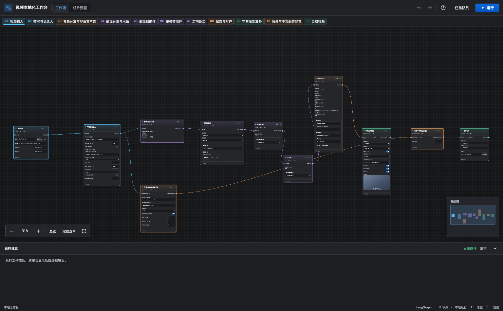
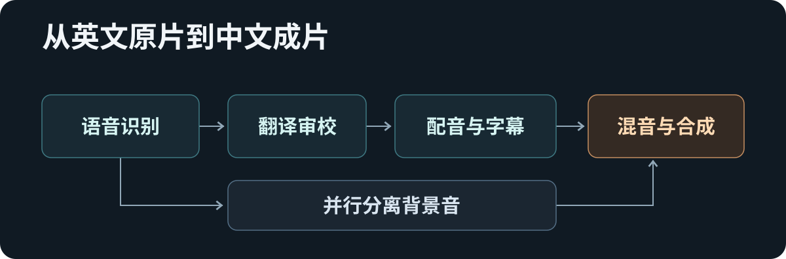

# 基于多智能体协作的英文视频本地化系统

把英文视频转成**带普通话配音和中英双语字幕的 MP4**。可以提交本地视频、单条 YouTube 链接，或者复用已经下载或上传的素材。运行后可以在浏览器里对照原片与成片、检查翻译各阶段的字幕，也可以取出 SRT 和结构化中间产物。

项目来自七人课程小组。LangGraph 负责调度，翻译、审校与定向返工由语言模型完成，语音识别、时间对齐、音轨处理与字幕压制由各自的模型或媒体工具完成。

[快速开始](#快速开始) · [工作流](#工作流) · [配置](#配置) · [任务文件](#任务文件) · [测试与实验](#测试与实验) · [常见问题](#常见问题)

## 工作台



工作台展示实际运行的 11 个节点。左侧按步骤定位节点，画布展示依赖关系，任务队列和运行日志用于查看每次译制的进度。打开「成片预览」后，可以按时间戳对照英文原文、首次翻译和审校结果。成片就绪后可以切换原片与成片，或直接下载 MP4。

## 快速开始

### 1. 安装

准备 **Python 3.11**、[uv](https://docs.astral.sh/uv/)、FFmpeg、ffprobe，以及支持简体中文的字体。FFmpeg 和 ffprobe 放入 PATH，Windows 也可放在仓库的 `.tools/ffmpeg/bin/`。下载 YouTube 时可能还需要可执行的 Node.js，可通过 `LOCALIZER_NODE_PATH` 指定。

```bash
git clone https://github.com/AchiDilyar/english-video-localizer.git
cd english-video-localizer
uv sync --locked --extra b-asr --extra speech --extra tts --extra sound-events
```

如果只想查看工作台或使用下载入口，可以改用 `uv sync --locked --extra b-asr`。完整安装会拉取 PyTorch 和说话人识别等依赖，默认建议先在 CPU 环境验证。平台差异和 GPU 环境见 [语音识别环境说明](docs/nodes/asr_diarize/environment/README.md)。

### 2. 打开工作台

从仓库根目录启动。以下命令使用已经安装的依赖组合。

```bash
uv run --no-sync python scripts/serve_workflow_ui.py
```

打开 [本地工作台](http://127.0.0.1:8765/)。仅打开界面无需模型权重和服务密钥。端口占用时在启动命令末尾加 `--port 8766`。工作台监听本机回环地址。

### 3. 准备一次真实运行

1. 按[本地模型](#本地模型)一节准备 Whisper 和说话人模型。
2. 打开顶栏「API 设置」，填入 DeepSeek 兼容翻译接口和 DashScope 配音设置。两套服务分别需要有效凭据。
3. 首次验证建议在本机的 `config/tts.toml` 里设置 `voice_mode = "system"`，并检查系统音色在所选地域可用。仓库配置默认是 `cloned`。如果使用原声复刻，先取得说话人授权，再为当前任务勾选授权。
4. 在「视频输入」选择一段有权使用、音质清晰的英文 MP4、单条 YouTube 链接，或已经登记的素材。建议先用一段短片验证流程。
5. 点击「运行」，在任务队列看进度。成功后，在「成片预览」查看结果，或下载成片。最终文件位于该任务的 `video/final.mp4`。

### 命令行

使用系统音色时，先按上文调整本机 TTS 配置。工作目录需先创建，建议每次使用新的空目录。下面是 macOS 或 Linux 示例，PowerShell 可用 `New-Item -ItemType Directory -Force jobs/local-demo` 创建工作目录。

```bash
mkdir -p jobs/local-demo
uv run --no-sync run-input --work-dir jobs/local-demo --input "/绝对路径/英文视频.mp4"
```

`--input` 也接受一条 YouTube 视频链接，CLI 会先获取原片，再运行整条工作流。使用原声复刻模式且已取得授权时，为这次运行加 `--authorize-voice-clone`。只希望下载原片时，使用独立的下载命令：

```bash
uv run --no-sync download-video "https://www.youtube.com/watch?v=视频ID" --output-dir media/downloads
```

把 `视频ID` 换成实际视频 ID。同一链接优先复用已登记的原片。默认最高 720p、最长 2 小时、最大 2 GiB，单次下载时限 600 秒。详细参数见 [命令行说明](docs/cli/README.md)。

## 工作流



| 阶段 | 输入与结果 |
| --- | --- |
| 素材准备 | 探测视频和音轨，把源视频解析到共享素材路径 |
| 英文理解 | faster-whisper 转写，Community-1 区分说话人。把带毫秒时间戳的分段组织成翻译块 |
| 翻译与审校 | 根据上下文、术语表和风格生成译文，审校后对问题片段定向返工，并保留每阶段文本 |
| 配音与时长适配 | CosyVoice 生成中文语音。按实际音频组时长比较时间窗，对超时组局部改稿，保留最终采用的音稿和测时记录 |
| 字幕 | 基于最终配音时间轴生成英文、中文、双语 SRT 与烧录 ASS。超宽内容按显示需要分页，源文字和配音分组仍可在中间文件中核对 |
| 背景与混音 | Demucs 分离背景，AST 尝试恢复合适的非语言事件。与配音混合后送入合成；增强链失效可回退纯配音 |
| 成片交付 | FFmpeg 合成中文音轨并烧录字幕，输出 `video/final.mp4` |

当前配音默认最多进行 **8 轮**时长返工，常规速度范围为 **0.95–1.35 倍**。用尽轮次后，采用最后有效稿，并可能超出常规加速范围，记录复听警告。该阶段跳过后续配音语义审查，需结合警告回听。

[主图实现](project/graph/builder.py) · [工作流设计](docs/design/workflow.md) · [配音时长与失败策略](docs/nodes/tts_align/README.md) · [背景分离](docs/nodes/b_environment/README.md)

## 配置

### 本地模型

权重需单独准备。路径相对于仓库根目录，可在各节点配置中调整。

| 用途 | 默认位置 | 配置 |
| --- | --- | --- |
| 英文转写 | `models/faster-whisper-base.en` | [转写](config/asr_diarize.toml) |
| 说话人区分 | `models/community-1-hf-cache` | [转写](config/asr_diarize.toml) |
| 最终中文音轨定位 | `models/faster-whisper-small` | [字幕](config/subtitle_cover.toml) |
| 背景分离 | `models/background-demucs/torchaudio/models/hdemucs_high_trained.pt` | [背景增强](config/b_environment.toml) |
| 非语言声音识别 | `models/ast-audioset/` 内的 `model.onnx` 与 `config.json` | [背景增强](config/b_environment.toml) |

下载两套 Whisper 权重：

```bash
uv run --no-sync python -c "from faster_whisper.utils import download_model; download_model('base.en', output_dir='models/faster-whisper-base.en'); download_model('small', output_dir='models/faster-whisper-small')"
```

用自己的账号申请 [Community-1 模型访问权限](https://huggingface.co/pyannote/speaker-diarization-community-1)，然后登录并缓存权重：

```bash
uv run --no-sync hf auth login
uv run --no-sync python -m nodes.asr_diarize.community1_worker --prepare-model --allow-model-download --cache-dir models/community-1-hf-cache
```

正常运行时使用本地模型。背景分离、事件检测是可回退的增强环节，可按[本地背景模型说明](docs/nodes/b_environment/README.md)另行准备。

### 翻译、配音与音色

建议用工作台「API 设置」写入本机配置，也可以手动在仓库根目录创建 `.env`。实际值按自己的账号、接口和地域填写。

| 环境变量 | 用途 |
| --- | --- |
| `DEEPSEEK_API_KEY` | 翻译、审校与文本返工 |
| `DEEPSEEK_BASE_URL`、`DEEPSEEK_MODEL` | 使用兼容接口时指定服务地址和该网关提供的模型 |
| `DEEPSEEK_TRANSPORT` | 一般用 `api`。`school_bridge` 依赖外部授权操作者处理文件交换 |
| `DASHSCOPE_API_KEY` | 中文配音服务凭据 |
| `DASHSCOPE_REGION` | 填账号实际使用的地域，并核对音色可用性 |
| `DASHSCOPE_WORKSPACE` | 使用独立业务空间时按账号配置填写 |

工作台保存后仅显示配置状态。密钥仍以本机文件保存，请勿提交 `.env` 或把密钥贴到 Issue。真实翻译、配音和创建复刻音色可能产生费用。开启原声复刻时，参考原声会上传至配音服务；授权仅对所选视频的当次任务有效。

### 字幕与导出

- [字幕样式目录](config/subtitle_styles.json) 定义字体、颜色、边距、描边与中英文排布，工作台和后端共用。
- [字幕任务配置](config/subtitle_cover.toml) 选择样式、语言排布与分页等参数。
- [合成配置](config/compose_video.toml) 管理输出分辨率与码率。工作台还可以选择成片导出位置。
- [节点模式](config/mock.toml) 中 `false` 为真实，`true` 为模拟。模拟用于联调，质量评估应使用真实数据。
- [翻译配置](config/translate_blocks.toml)、[建议口播字数](config/translation_timing.toml)、[配音配置](config/tts.toml) 与 [背景混音](config/mix_background.toml) 分别管理对应阶段。

## 任务文件

WebUI 每次提交创建 `jobs/日期_时间_微秒 视频标题/`，CLI 写入传入的 `--work-dir`。新上传或下载的原片通常独立保存在 `media/downloads/`，任务使用同一素材路径。队列中的「清空」只隐藏已结束记录，磁盘产物仍在。

| 文件或目录 | 内容 |
| --- | --- |
| `segments/` | 英文分段、说话人和翻译块 |
| `translated/` | 初译、审校、有效定向返工结果 |
| `tts/` | 音频片段、`dubbing_script.json` 和返工测时 |
| `audio/` | 源音轨、配音、可用时的背景和混音。复刻账号记录仅保存在本机 |
| `subtitles/` | `english_segmented.srt`、`chinese.srt`、`bilingual.srt` 和 `burnin.ass` |
| `video/final.mp4` | 最终成片 |
| `logs/` | CLI 日志、WebUI 运行日志与节点进度 |

删除任务目录会同时移除该次运行的日志、字幕和成片。移动或删除共享原片也会影响复用和原片预览。

## 测试与实验

在已经安装依赖的环境内执行快速测试：

```bash
uv run --no-sync pytest -m "not slow" -q
```

- **本次快速回归**在没有个人 `.env` 的干净副本运行，664 项通过、2 项跳过、4 项未选，另有 11 个子测试通过。
- **模拟与集成测试**覆盖输入校验、工作流依赖、并行进度、异常回退，以及用替身结果驱动 FFmpeg 生成真实 MP4 的链路。
- **历史约 35 分钟双人对谈实验**复用了同源识别与翻译产物，重新执行配音与字幕，记录 300 组语音、559 屏双语字幕。该结果对应当时版本和该样片。[配音实验记录](docs/nodes/tts_align/README.md)
- **时长策略重放**复用 120 秒样片的 24 组缓存语音，产出 42 屏双语字幕，没有新增收费调用。[重放说明](docs/nodes/tts_align/README.md)
- 实际结果受原片清晰度、说话人重叠程度、语速和模型影响。背景分离可能残留原语言或漏掉与对白重叠的声音。配音窗口与字幕分页检查无法替代人工听审。项目目前交付整段重跑，未提供通用的跨进程断点恢复入口。

做样片或对比实验时，请记录运行版本、节点模式、素材来源与实际执行环节。模型、运行素材和临时产物目录默认由 Git 忽略。

## 常见问题

| 现象 | 先检查什么 |
| --- | --- |
| 工作台无法打开 | 启动命令是否还在运行、是否访问了正确端口。切换代码版本后重启服务并刷新页面 |
| YouTube 下载失败 | 链接是否指向单条可访问的视频，FFmpeg、Node.js 和网络是否就绪 |
| Community-1 报 403 | 当前账号是否获准读取模型，本机是否已缓存权重 |
| 配音接口超时或音色不可用 | 地域、业务空间、模型和音色是否匹配，先用工作台连接测试检查 |
| 显示需要原声授权 | 获得说话人授权后在当前任务勾选，或选择合适地域内的系统音色 |
| 有字幕却没有成片 | 查最后一个失败节点及运行日志，再检查 FFmpeg、中文字体和 `video/final.mp4` |
| 配音过快或字幕错位 | 查看 `tts/` 中的时长告警和最终音稿，对照 `subtitles/` 时间戳并回听对应片段 |

## 开发与反馈

- 安装与开发约定见 [开发环境](docs/development.md)，操作与界面细节见 [工作台说明](docs/webui.md)。
- [接口契约](docs/contracts/interfaces.md) 描述数据边界。[主图说明](docs/graph/README.md) 和 [协作约定](docs/design/collaboration.md) 解释节点关系与集成方式。
- `project/` 包含命令行、节点和数据契约，`web/` 是浏览器界面，`scripts/` 提供工作台服务和检查工具，`tests/` 保存测试。
- 提交 [问题反馈](https://github.com/AchiDilyar/english-video-localizer/issues) 时，可附运行入口、版本、操作系统、失败节点、脱敏日志和最小复现步骤。请先确认公开附件有分享权。
- 课程小组的职责见 [协作分工](docs/roles/README.md)。测试媒体的来源和署名见 [素材说明](tests/data/asr_diarize/real_dialogue/README.md)。
