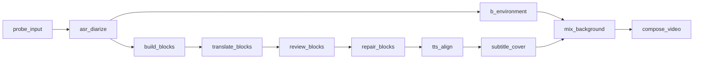

# 基于多智能体协作的英文视频本地化系统

七人课程项目，使用 **LangGraph** 协调英文视频转写、翻译审校、中文配音和双语字幕制作。输入本地视频或单条YouTube链接，目标是输出带中文配音、双语字幕的视频，并保留结构化结果供检查和对接。

媒体探测、语音识别、音轨处理和压制由工具完成；理解、翻译、审校和配音稿返工由大模型角色承担，不将每个媒体工具都称作独立智能体。

**当前状态（2026-11-17）：** 已接入真实节点，并完成约35分钟双人对谈的本地实验。该实验B/C复用同源真实结果，D/E重新运行，不代表所有环节重新全量推理，也不代表生产、GPU和全部慢测已验收。

**本轮更新：** 已上传 WebUI 原片/成片预览切换、密钥不回显的 API 设置（地域可填写）、原片共享复用、授权后的自动音色准备、本地模型检查，以及 B/E 真实背景分离与混音。完整代码改动见 [2d2e648（52个文件）](https://github.com/AchiDilyar/english-video-localizer/commit/2d2e648)，使用与验证说明见 [WebUI 文档](docs/webui.md)。后续合并提交同时保留了团队 PPT 更新，不能只凭最后一次合并的文件列表判断代码是否已上传。个人密钥、接口配置和音色账户记录仅留本机。

## 1. 功能与流程

| 功能 | 当前支持情况 |
|---|---|
| 素材入口 | 本地视频；yt-dlp下载单条YouTube公开视频 |
| 转写与说话人 | 本地faster-whisper及Community-1，需预先准备权重和访问权限 |
| 翻译与审校 | DeepSeek接口、术语/风格配置、建议字数预算和定向返工 |
| 中文配音 | CosyVoice v3 flash；系统音色或预先授权登记的原声复刻音色 |
| 时长适配 | 按实际音频测量并局部改稿；后期0.95–1.35倍，不裁语音句尾 |
| 双语字幕 | 配音后生成；中文上、英文下居中，各一行；超宽只在显示阶段顺序分页 |
| 背景音 | 主图 b_environment / mix_background 已启用真实处理；本地 Demucs 分离背景、AST 保守恢复非语言声音，再混入中文配音。需本地模型与 speech / sound-events 依赖，失败按增量规则回退纯配音 |
| WebUI | 本地MP4、YouTube链接或已有素材输入；直接复用原片，显示11节点进度、日志；字幕预览可切换原片/成片，API设置支持密钥隐藏与可填写地域 |

当前代码执行顺序：



唯一运行主图为 `project/graph/builder.py`，拓扑以 [workflow.md 第4节](docs/design/workflow.md) 为准。背景链与翻译链并行，混音等待两条链。字幕等待最终音轨，避免使用配音返工前的旧稿。共享节点仍为 `state: GraphState -> dict`，字段以 `contracts/` 为准。增量缺失或失败时回退纯中文配音，未返回本次有效混音状态时不消费磁盘旧混音。

### 主图设计：基础版节点 + 增量节点

主图按“基础版节点 + 增量节点”组织：基础版节点承担主链路；增量节点用于后续增强，在完成“英文视频的字幕与配音”的基础上，提升输出视频的质量。增量节点始终注册并调度，不提供关闭开关。`graph/` 层对增量节点统一加代理：节点抛异常时记 `warning` 并返回空增量，基础版节点仍直接抛出、图终止。节点清单与产物表用“版本归属”列区分基础版/增量。在该设计下，增量节点失败不会拖垮基础版链路，增量返回空增量时基础版行为不变。具体规则见 `docs/design/architecture.md` 第 8 节。边界：代理只保证异常不外抛、不合并返回值，不回滚节点对 State 的原地修改或已写磁盘的半成品。这一设计虽然属于架构治理，但能体现多智能体协作的异常处理和调度思路。

### mocks 模块

`mocks/` 为各节点提供模拟实现：保证结构性正确、不保证结果正确，用占位数据让整条链路在无模型、无密钥时也能跑通；凡是结果可能不对的地方留下可 grep 的 warning，切到 mock 即接受结果不正确。

## 2. 安装环境

需要Python **3.11**、[uv](https://docs.astral.sh/uv/)、FFmpeg和ffprobe。后两者加入PATH，或在Windows放到`.tools/ffmpeg/bin/`。字幕需支持中文的字体。YouTube完整支持可能需要Node.js等JavaScript运行时；程序查找PATH上的Node，也可设置`LOCALIZER_NODE_PATH`。

```powershell
git clone https://github.com/AchiDilyar/english-video-localizer.git
cd english-video-localizer

# 仅下载、打开界面或进行B的基础检查
uv sync --locked --extra b-asr

# 真实完整流程，包括说话人区分、配音和可选声音事件依赖
uv sync --locked --extra b-asr --extra speech --extra tts --extra sound-events
```

`speech`包含Community-1所需的PyTorch/pyannote，体积较大；只装`b-asr`不等于能运行真实说话人区分。默认CPU，CUDA需另验硬件和环境。[B环境说明](docs/nodes/asr_diarize/environment/README.md) · [开发环境](docs/development.md)

依赖声明在`pyproject.toml`、锁定在`uv.lock`。新增依赖使用`uv add`、`uv add --dev`或`uv add --optional <extra>`；不使用pip或手改锁文件。运行、测试统一用`uv run`。

## 3. API、模型与音色准备

### API配置

首次复制模板，**已有`.env`不要覆盖**：

```powershell
if (-not (Test-Path .env)) { Copy-Item .env.example .env }
```

在本机`.env`填写：

也可打开 WebUI 顶栏「API 设置」填写翻译接口地址、模型、密钥及配音地域、模型、业务空间、密钥。密钥不回显，留空保留，清除需单独勾选；只写本机配置，下次任务生效，运行中禁止修改。仓库仅提供空值/通用示例，不包含个人网关或账号资料。声音复刻另需在当前视频勾选授权，不能由 API 配置代替授权。

| 配置 | 用途 |
|---|---|
| `DEEPSEEK_API_KEY` | 默认HTTP通道的翻译、审校、音稿返工和可选语义分片 |
| `DEEPSEEK_TRANSPORT=api` | 默认文本模型通道；模型名可通过`DEEPSEEK_MODEL`设置 |
| `DEEPSEEK_BASE_URL` | 可选兼容网关地址；个人地址仅保存在本机，不写入代码 |
| `DASHSCOPE_API_KEY` | 中文语音生成，不能用DeepSeek密钥代替 |
| `DASHSCOPE_REGION=ap-southeast-1` | 当前实验使用新加坡地域，须与账号、音色一致 |
| `DASHSCOPE_WORKSPACE` | 可选工作空间，以账号实际配置为准 |

真实翻译、审校、配音和首次音色创建**可能收费**。只下载视频或打开WebUI不会自动触发这些调用；启动真实节点需要对应凭据。程序不推断余额或实际账单，本地预算可通过`LOCALIZER_BUDGET_FILE`另行配置。

学校`school_bridge`是文件交换通道，需要授权平台工具/操作者处理请求，不是普通终端直接可用的学校API，也不等于自动续跑。密钥留在本机，不提交`.env`或音色账户记录。

### 本地模型

权重不随仓库分发，默认路径如下；可通过对应配置文件修改。

| 模型 | 默认路径 | 配置文件 |
|---|---|---|
| 英文Whisper | `models/faster-whisper-base.en` | `config/asr_diarize.toml` |
| Community-1缓存 | `models/community-1-hf-cache` | `config/asr_diarize.toml` |
| 最终中文音轨Whisper | `models/faster-whisper-small` | `config/subtitle_cover.toml` |
| 背景Demucs | `models/background-demucs/torchaudio/models/hdemucs_high_trained.pt` | `config/b_environment.toml` |
| 非语言事件AST | `models/ast-audioset/model.onnx` 和 `config.json` | `config/b_environment.toml` |

完成上面的完整`uv sync`后，可准备Whisper权重；以下`--no-sync`保持已安装的依赖组合：

```powershell
uv run --no-sync python -c "from faster_whisper.utils import download_model; download_model('base.en', output_dir='models/faster-whisper-base.en'); download_model('small', output_dir='models/faster-whisper-small')"
```

Community-1需要本人登录Hugging Face并在[模型页面](https://huggingface.co/pyannote/speaker-diarization-community-1)取得访问权限，登录不等于获准访问。之后在本机终端运行：

```powershell
uv run --no-sync hf auth login
uv run --no-sync python -m nodes.asr_diarize.community1_worker --prepare-model --allow-model-download --cache-dir models/community-1-hf-cache
```

凭据只在终端输入，不贴到聊天或提交仓库。准备模型需要网络；正常识别阶段读取本地权重。`community1_python`保持为空，沿用当前uv解释器，不直接指向历史Python环境。

### 系统音色与原声复刻

`config/tts.toml`当前默认`voice_mode = "cloned"`，在本次任务获得授权后，配音节点可自动选取原声并创建 audio/voice_profiles.json；已有且音频/账号/模型/地域/人物时间轴匹配的记录可直接复用。

- 先验证流程时，可在本机临时设置`voice_mode = "system"`并选同地域可用的系统音色，避免把个人测试配置随意覆盖团队配置。
- 复刻前需取得说话人的声音使用及参考原声上传授权，再按[D节点说明](docs/nodes/tts_align/README.md)和`nodes.voice_profiles.enroll_profiles`准备绑定记录。在 WebUI 视频输入勾选本次任务的原声上传与付费音色创建授权后，可自动完成；新素材会重置勾选。
- 记录绑定源音轨摘要、模型和地域，不应直接复制其他视频或账号的记录。缺失或不匹配会明确报错。

## 4. 运行方式

### 只下载YouTube视频

```powershell
uv run --locked --extra b-asr download-video "https://www.youtube.com/watch?v=jNQXAC9IVRw" --output-dir media/downloads
```

原片直接保存在 media/downloads/<视频ID>/video.mp4，来源记录为该目录的 source.json。相同链接复用原文件。这条命令**不运行翻译或配音**，目录自动创建。默认最高720p、最多2小时、2GiB、下载时限600秒，只取单条视频，不批量下载列表。失效、登录/地区限制或DRM等情况不保证可用；下载成功不等于取得转载或复刻授权。

### CLI真实工作流

先准备模型、API和音色。每个任务使用新目录，直接传原视频绝对路径，无需复制：

```powershell
New-Item -ItemType Directory -Force jobs/local-demo
uv run --locked --extra b-asr --extra speech --extra tts --extra sound-events run-input --work-dir jobs/local-demo --input "C:/Videos/english.mp4" --authorize-voice-clone
```

也可直接传YouTube链接，CLI先获取共享原片路径，再执行主图：

```powershell
New-Item -ItemType Directory -Force jobs/youtube-run
uv run --locked --extra b-asr --extra speech --extra tts --extra sound-events run-input --work-dir jobs/youtube-run --input "https://www.youtube.com/watch?v=jNQXAC9IVRw"
```

两条`run-input`都会继续运行真实节点，**不是只下载命令**。URL输入会复用已下载素材，不在任务中生成 input.mp4；处理输出目录仍需新建，重复使用已产出音轨/转写的目录也可能被拒绝。当前基础CLI不保证检查点续跑，重复启动不等于恢复本地实验脚本进度。

### WebUI

只查看界面：

```powershell
uv run --locked --extra b-asr python scripts/serve_workflow_ui.py
```

打开`http://127.0.0.1:8765/`。在「视频输入」切换到「YouTube 链接」，填入原片地址并点击「运行」，下载完成后自动进入翻译、配音、字幕和合成；也可继续上传本地MP4。若要实际运行完整流程，在完成全部准备后用完整依赖启动：

```powershell
uv run --locked --extra b-asr --extra speech --extra tts --extra sound-events python scripts/serve_workflow_ui.py
```

当前界面上传本地MP4；YouTube先通过下载命令获取，再上传文件。可查看队列、节点模式、配置、字幕和控制台。`config/mock.toml`决定真实/模拟节点，当前main为全真实；打开页面无需API key，不代表运行也无需配置。[WebUI详细说明](docs/webui.md)

## 5. 配置与输出

| 配置文件 | 主要作用 |
|---|---|
| `config/mock.toml` | 真实/模拟开关，`true`为模拟，`false`为真实 |
| `config/asr_diarize.toml` | 英文模型、最长时长、说话人、CPU/CUDA及复核 |
| `config/translate_blocks.toml` | 翻译风格与术语 |
| `config/translation_timing.toml` | 建议字数预算，不能代替实际测时 |
| `config/b_environment.toml` | 本地背景分离与非语言事件恢复；模型路径及CPU/CUDA |
| `config/mix_background.toml` | 背景混音增益 |
| `config/tts.toml` | 模型、音色、变速与返工策略 |
| `config/subtitle_cover.toml` | 最终音轨字幕、双语位置、分片和严格单行 |
| `config/compose_video.toml` | 输出分辨率与码率 |

典型任务目录：

```text
jobs/local-demo/
  input.mp4
  audio/        # source.wav、dub.wav；voice_profiles.json为本机复刻配置
  segments/     # segments.json、blocks.json
  translated/   # 初译、审校；有效定向返工后才有repaired_blocks.json
  tts/          # clips.json、逐组音频、最终实际音稿和时长记录
  subtitles/    # 中英SRT、双语SRT、burnin.ass、对齐及分页警告
  video/        # final.mp4：最终成片
  logs/         # run.log；WebUI任务另有runner.log
```

最终配音文本以`tts/dubbing_script.json`为准，不把`TTSClip.text`标签当成每段音频逐字实录。英文不回译或改写，显示分页不改配音分组。背景/混音使用登记的独立音轨和可选状态回执，由 mock.toml 统一选择真实/模拟实现；缺失增量时维持纯配音。

## 6. 测试、实验与限制

- 最近合并快测：**528 passed、2 skipped、2 deselected、11 subtests passed**，跳过/未执行项不算通过。
- 历史35分钟实验：300组新配音、559屏双语单行、0越界，实际0.95–1.35倍；B/C复用同源结果，D/E真实重跑。9组留白、29屏短显示需复听。
- 自动检查不等于整片人工听音、原声相似度、说话人准确性、逐词对齐或口型验收。背景分离可能漏掉与对白重叠的笑声，也可能残留原语言混响。
- 默认短稿策略为`error`，无法忠实适配时可能返工或报错；历史实验有警告继续是显式配置，不代表默认无限放慢或静默凑词。
- 背景及混音产物已登记；真实分离质量、GPU、旧慢测SDK适配及其他辅助产物的规范化仍需后续验收。

快测命令不调用真实付费API；真实说话人模型/慢测需另行启用对应依赖、权重与授权：

```powershell
uv run --locked --extra b-asr --extra tts --extra sound-events pytest -m "not slow" -q
```

35分钟[实验下载](https://github.com/AchiDilyar/english-video-localizer/releases/tag/experiment-long35-20261117)约922MB，包内只有**一份实验报告、原视频和最终成片**。中间文件、模型、音色账户记录和密钥不上传Git。

## 7. 常见问题

| 情况 | 先检查 |
|---|---|
| YouTube下载失败 | 视频是否仍可用、网络、yt-dlp锁定版本、Node/FFmpeg；视频失效不等于插件没装 |
| 模型缺失或Community-1返回403 | 路径/缓存是否准备；当前账号是否真正获准访问模型 |
| 缺API key或地域错误 | `.env`位置、独立的两类密钥，以及音色与新加坡地域是否匹配 |
| `VOICE_CLONE_REQUIRED` | 源摘要、授权音色记录、模型和地域；普通验证可显式使用system模式 |
| 配音长短不合适 | 查看`tts/`的测时和返工记录，不靠超速、丢字或裁句尾掩盖问题 |
| `UNTIMED_UTTERANCES`、`UNRESOLVED_SPEAKER` | 先解决时间或说话人缺失，不把未知结果标成人工确认 |
| 端口占用或旧界面 | 使用`--port 8766`等新端口，重启服务并刷新页面 |

## 8. 目录与团队资料

```text
project/      # CLI、graph、contracts、nodes、mocks、utils
config/       # 团队配置
scripts/      # WebUI、辅助检查和运行报告
web/          # 界面静态资源
tests/        # 测试；tmp和_large不进Git
docs/         # 设计、节点说明、协作与汇报资料
models/       # 本地模型，不进Git
jobs/         # 本地任务，不进Git
```

A负责整体方案与演讲，B素材和语音理解，C翻译审校，D配音时长，E字幕成片，F集成与公共接口，G负责PPT与展示材料。

- [项目规划](docs/project-plan.md) · [开发环境](docs/development.md) · [团队分工](docs/roles/README.md)
- [设计架构](docs/design/architecture.md) · [工作流](docs/design/workflow.md) · [数据流](docs/design/dataflow.md) · [协作约定](docs/design/collaboration.md)
- [主图说明](docs/graph/README.md) · [CLI说明](docs/cli/README.md) · [B节点](docs/nodes/asr_diarize/README.md) · [D节点](docs/nodes/tts_align/README.md)

协作时先同步main，保留其他成员工作；跨组接口、主图和正式设计由F协调。依赖、密钥与大文件遵循上述规则，实验结果、模型建议及人工验收结论分别记录。
