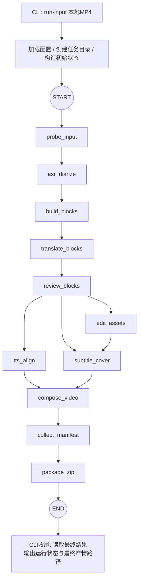

# 项目工作流设计（workflow.md）

版本：v1.2.0
最后更新：2026-11-09

---

## 1. 文档定位与事实源范围

### 1.1 本文档负责什么

本文档描述基本版项目工作流，包括：

- 节点命名约定；
- 节点清单：节点名、角色、职责、读产物、写产物；
- 工作流图：节点依赖与并行关系；
- 基本版边界。

### 1.2 本文档是以下内容的唯一事实源

> 唯一事实源指：以下概念**只在该文档定义**，其它文档可以引用这些概念，但**不可重新定义**。如果出现名称不一致，以该文档的名称为准，引用该概念的文档应尽快同步修改。

| 事实 | 对应章节 | 说明 |
|---|---|---|
| 节点名 | 第3节 节点清单 | 所有文档、代码中出现的节点名以此为准 |
| 节点职责 | 第3节 节点清单 | 每个节点需要完成什么任务 |
| 节点读写产物关系 | 第3节 节点清单 | 哪个节点读哪些产物、写哪些产物 |
| 节点与角色的对应关系 | 第3节 节点清单 | 哪个节点由 B/C/D/E/F 负责 |
| 节点依赖与并行关系 | 第4节 工作流图 | 谁在谁之后、谁可并行、谁必须汇合 |
| 基本版范围边界 | 第5节 基本版边界 | 哪些功能明确不在该版本实现中 |

补充说明：

- `节点读写产物关系`仅规定涉及哪些产物，不包括产物的具体描述和内容
- `节点依赖与并行关系`是工作流中的依赖与并行关系，不是模块开发时的依赖与并行关系

### 1.3 文档引用约定

- 本文档引用的产物名与磁盘路径以 `dataflow.md` 为准；
- 本文档引用的代码文件名与函数名以 `architecture.md` 为准

---

## 2. 节点命名约定

### 2.1 命名格式

- 节点名使用小写英文加下划线，例如 `asr_diarize`、`tts_align`。
- 节点名是操作名，不是字段名；不得由节点名派生同名字段。
- 节点名必须与 LangGraph 图构建代码中的节点注册名完全一致。

### 2.2 跨层一致性

以下四处必须使用同一个名字：

- `workflow.md` 节点清单中的节点名
- `architecture.md` 中约定的节点模块名
- 节点模块主函数名
- `graph.py` 中 `add_node` 的注册名

### 2.3 改名流程

- 节点改名属于接口级变更；
- 需更新本文档节点清单、工作流图、依赖说明；
- 需同步更新 `architecture.md` 中的模块名和函数名；
- 需更新 `graph.py` 中的注册名；
- 需在 `docs/design/CHANGELOG.md` 中记录，写明改了什么、为什么改、影响哪些模块。

---

## 3. 节点清单

| 节点 | 角色 | 职责 | 读产物 | 写产物 |
|---|---|---|---|---|
| `probe_input` | B | 探测输入视频的时长、分辨率、音视频流信息 | 输入视频 | 媒体信息 |
| `asr_diarize` | B | 从输入视频提取音轨，做英文转写与说话人区分，生成全片时间轴分段 | 输入视频 | 提取音频、分段结果 |
| `build_blocks` | C | 在自然句边界把分段聚合为翻译块，并维护术语表 | 分段结果 | 翻译块、术语表 |
| `translate_blocks` | C | 翻译智能体为每个分段生成中文字幕文本和中文口播稿 | 翻译块、术语表 | 翻译结果 |
| `review_blocks` | C | 审校智能体检查术语一致性和明显错漏，输出可用译文 | 翻译结果、分段结果 | 审校结果 |
| `tts_align` | D | 按说话人音色合成中文口播音频，测时长并对齐原时间窗，组装整条中文配音音轨。音色映射需要作为配置项维护。 | 审校结果 | 分段音频清单、分段音频文件、中文配音音轨 |
| `edit_assets` | E | 中文编辑智能体生成标题、简介和封面文案 | 审校结果、媒体信息 | 发布文案 |
| `subtitle_cover` | E | 生成双语 SRT、烧录字幕和封面图 | 审校结果、发布文案 | 双语 SRT、烧录字幕、封面图 |
| `compose_video` | E | 用中文配音替换原音轨，烧录双语字幕，合成中文配音成片 | 输入视频、中文配音音轨、烧录字幕 | 成片 |
| `collect_manifest` | F | 汇总发布包产物清单，不重新生成业务产物 | 各产物 | 发布包清单 |
| `package_zip` | E | 按发布包清单打包 ZIP | 发布包清单、各产物 | 最终 ZIP |

---

## 4. 工作流图

> 图中只使用第 3 节节点清单中的节点名，不重复节点职责。

图说明：

- 实线表示依赖关系，箭头方向为执行顺序。
- `tts_align`、`edit_assets`、`subtitle_cover` 三者在 `review_blocks` 之后可并行。
- `subtitle_cover` 额外等待 `edit_assets`，因为封面图需要发布文案。
- `compose_video` 等待 `tts_align` 和 `subtitle_cover`。
- `collect_manifest` 等待所有发布包产物就绪。
- `package_zip` 是最后一个业务节点，完成后图进入 `END`。
- CLI 入口出口的具体约定见 `architecture.md`。

---

## 5. 基本版边界

本版明确**不包含**：

- 双入口（仅本地 MP4，不含 YouTube 链接）；
- 错译退回、配音超时退回等异常分支；
- 中断续跑与 SQLite 检查点；
- 网页界面；
- 声音克隆、背景声分离、口型同步、重叠发音精细处理；
- 测试体系、日志体系、评测汇总、团队协作流程。

这些作为后续版本增量，不在该版本工作流中体现。
