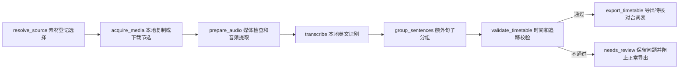

# B LangGraph 子流程：使用与对接接口

> 历史阶段记录：代码与文档已按 v1.2.0 迁移。旧路径、命令和“尚未实现”等状态仅对应记录当时，不作为当前入口；当前使用与限制见 [节点说明](README.md) 和 [迁移记录](B-layout-v1.2.0.md)。历史任务未修改。
更新：2026-11-07。**已实现并运行真实 LangGraph，不只是接口提案。** 本模块覆盖 B 的素材准备、英文 ASR、原片段/词时间保留、额外句子分组及台词时间表导出。不含 C/D/E 智能体、翻译、配音、成片或团队完整主图。

后续长视频扩展：[完整下载与分块接口](B-long-video.md)。下文120秒、仅节选下载等描述属于首版短片阶段；最新完整文件下载、60分钟参数上限与块级缓存以长视频说明为准。旧结果和运行证据保留。

## 1. 先看真实运行结果

| 结果 | 内容 |
|---|---|
| [登记链接流程核对页](../../../jobs/B-LangGraph-MIT-20261107-01/review.html) | 真下载 + 真识别 + 参考分组；18 原片段、148 词、11 分组 |
| [本地文件流程核对页](../../../jobs/B-LangGraph-local-auto-20261107-01/review.html) | 本地读入 + 真识别 + 通用规则分组；18 原片段、148 词、11 分组 |
| [链接流程台词 JSON](../../../jobs/B-LangGraph-MIT-20261107-01/timetable.json) | 后续工作主要读取的结构化结果 |
| [原片段 CSV](../../../jobs/B-LangGraph-MIT-20261107-01/segments.csv) | 毫秒时间、原课时间、英文、说话人方法 |
| [句子分组 CSV](../../../jobs/B-LangGraph-MIT-20261107-01/sentence-groups.csv) | 来源片段、分组时间、拼接原文、阅读版本、原因 |
| [词级 CSV](../../../jobs/B-LangGraph-MIT-20261107-01/words.csv) | 每个词的 ID、时间、原始后端概率 |
| [运行证据](B-LangGraph-run-20261107.md) | 实际节点、失败恢复、暂停续跑、测试与限制 |

jobs/ 产物在本地，不随 Git 推送。review.html 通过任务目录里的 source/video.mp4 播放；完整移动任务目录可以保留相对视频引用。单独把 HTML 拷到桌面会失去视频关系。

## 2. 实际节点与职责



代码位于 b_pipeline/，独立于 F 的最终主图命名。LangGraph 1.2.20 + langgraph-checkpoint-sqlite 3.1.3，使用真实 StateGraph、条件边、SQLite 检查点和流式节点执行。实际生成的图结构见任务目录 graph.mmd。

ASR 使用 faster-whisper 1.2.1、CTranslate2 4.8.5、英文 base.en，CPU int8，4 线程；PyAV 16.1.0。模型、代码、FFmpeg 与包版本通过指纹固定，恢复时变化会拒绝复用，要求新建任务。

## 3. 素材范围接口

### 登记表

[configs/b_sources.example.json](../../../tests/data/asr_diarize/b_sources.example.json) 是公开可共享的实际示例，只有 MIT 授权素材。格式版本 `b-sources-1`，顶层 sources 数组。实际账号令牌、带签名地址和私有素材位置不要提交该示例；另存本地登记表。

每条登记至少包含：

| 字段 | 说明 |
|---|---|
| source_id | 唯一素材 ID；最推荐用它调用 |
| kind | local 或 https_excerpt |
| page_url | 来源页面 |
| authorization_status | confirmed 才允许处理；该值应由有依据的人工登记，不由模型猜测 |
| license / license_url / attribution | 许可、链接和署名；独立授权也需提供可引用依据 |
| original_offset_ms | 当前样片起点映射回原视频的偏移；普通完整本地视频为 0 |
| changes | 节选、转码等修改说明 |

local 另外需要 local_path，路径相对登记表目录；可以提供 expected_sha256，文件变化时拒绝读取。

https_excerpt 另外需要 media_url（公开 HTTPS）、excerpt_start_sec 和 excerpt_duration_sec。起点需非负，时长在 (0,120] 秒，original_offset_ms 必须与起点一致。

这里的“素材识别”是识别用户输入对应的登记项，不是让大模型自动搜索网站或自动判定版权。支持按素材 ID、唯一登记链接、登记本地路径选择；不会下载任意未登记链接，也不内置 YouTube 抓取器。同一页面登记了本地和远程两份时，页面链接会歧义，使用明确的 source_id。

### 可调用函数

```python
from b_pipeline.sources import list_sources, select_source

choices = list_sources('configs/b_sources.example.json')
selected = select_source('mit-python-remote-45s', 'configs/b_sources.example.json')
```

list_sources 返回登记项，适合调用方填选择列表。select_source 返回验证后的登记项，local_path 已解析为绝对路径；未知、歧义、待授权或范围非法分别抛 BError。

### 资源边界

- 新任务默认不联网，下载必须显式 allow_network=True / --allow-network。
- 当前是短样片阶段：视频最长120秒，默认max_duration_sec=120，可下调；本地输入最多100 MiB，远程节选输出最多20 MiB。
- 下载是 FFmpeg 远程定位读取节选，不保存完整原课；网络实际读取总字节数 unknown，不把输出大小等同于下载流量。
- 下载处理上限180秒、单次网络读超时15秒；prepare_audio 上限120秒。失败不会无限重试。网络问题由明确的 resume 重试，并保留事件日志。
- 登记项必须指向可信公开媒体；本地 CLI 不作为面对任意不可信网络用户的下载服务。没有实现网页搜索、鉴权站点或对所有重定向主机进行沙箱隔离。
- 30/60分钟压测不在本版支持范围；扩展前需要调整切块协议、资源限制并增加长视频验证，不能只删除上限。

## 4. 新任务与恢复接口

```python
import os
os.environ['LANGSMITH_TRACING'] = 'false'
os.environ['LANGCHAIN_TRACING_V2'] = 'false'

from b_pipeline import run_b, resume_b

result = run_b(
    input_ref='mit-python-remote-45s',
    registry_path='configs/b_sources.example.json',
    model_dir='models/faster-whisper-base.en',
    job_dir='jobs/B-new-job',
    allow_network=True,
    speaker_mode='single_assumed',
    stop_after='transcribe',  # 可选：验证识别后暂停，不需要则省略
)

# 同一任务继续分组、校验、导出；不传新输入或模型。
result = resume_b('jobs/B-new-job')
```

run_b 其他可选参数：max_duration_sec、audio_stream、video_stream（两者均为 FFprobe 绝对流索引）、group_plan 与 reference_asr（必须一起提供）。已有任务目录不覆盖。

返回 BState 字典，主要包括 job_dir、job_status、next_nodes、media_ref、audio_ref、asr_ref、groups_ref、timetable_ref、artifact_hashes。ref 均相对 job_dir。job_status 是 paused、ready_for_human_review 或 blocked_validation；异常时保留 failed 状态及事件，抛出异常。

任务内 request.json 固定登记快照、输入哈希、模型和代码指纹。checkpoints.sqlite 保存图状态；events.jsonl 记录节点开始、完成、失败和耗时。节点还保留带哈希的阶段缓存，用于检查点提交前的安全重入；已有文件变化则报错，不悄悄复用。

恢复先校验已完成产物。已完成任务再次 resume 不重跑 ASR。进程异常退出可能留下 .running.lock；先确认没有该任务进程运行再处理，不自动删除未知锁。

## 5. CLI

在仓库根目录运行：

```powershell
# 查看登记范围
.\.venv\Scripts\python.exe -m b_pipeline sources --registry configs/b_sources.example.json

# 本地视频，无网络；新输出目录
.\.venv\Scripts\python.exe -m b_pipeline run --input mit-python-local-45s --registry configs/b_sources.example.json --model-dir models/faster-whisper-base.en --job-dir jobs/B-local-new

# 下载已登记节选，运行真实模型，使用通用候选分组规则
.\.venv\Scripts\python.exe -m b_pipeline run --input mit-python-remote-45s --registry configs/b_sources.example.json --model-dir models/faster-whisper-base.en --job-dir jobs/B-remote-new --allow-network

# 恢复
.\.venv\Scripts\python.exe -m b_pipeline resume --job-dir jobs/B-remote-new
```

CLI 会在进程内关闭 LangSmith/旧 LangChain 远程追踪，不调用外部文本模型。退出码0表示流程完成或按要求暂停，不表示语音和时间准确性已被人工证明；校验阻断为5，运行错误为3，参数解析错误为2。

## 6. 台词时间表接口：C/D/E 读取

```python
from pathlib import Path
from b_pipeline import load_timetable

job = Path('jobs/B-LangGraph-MIT-20261107-01')
table = load_timetable(job / 'timetable.json')
original_predictions = table['original_segments']
timed_segments = table['segments']
sentence_groups = table['sentence_groups']
```

load_timetable 会检查格式、覆盖、原词追踪、时间范围和一致性。它不宣称英文语义或词边界已正确；调用方仍要读取 verification。

### 顶层格式 `b-timetable-1`

| 字段 | 含义 |
|---|---|
| source | 素材来源、许可和偏移 |
| duration_ms / original_offset_ms | 样片时长与原课映射偏移 |
| media_sha256 | 当前处理视频哈希 |
| asr | 识别引擎、参数、模型/代码/依赖指纹和真实耗时 |
| original_segments | 原始识别片段完整保留；含原始秒时间及词记录 |
| segments | 标准毫秒片段与原始片段编号对应 |
| sentence_groups | 额外句子分组，只引用原片段，不覆盖它们 |
| verification | 文字、时间、分组是否人工确认；是否跑过自动说话人区分 |
| grouping_method / notes | 分组方法、限制 |

segments 每项：segment_id、original_segment_id、speaker_id、speaker_method、start_ms、end_ms、en、words。words 每项保留 word_id、original_word_index、text、start_ms、end_ms 及 raw_word 原样记录。

sentence_groups 每项：group_id、source_segment_ids、original_source_segment_ids、start_ms/end_ms、en_exact_join、en_reading、reason、reading_edit、boundary_note、human_grouping_confirmed 及保留来源索引的 words。

- 新编号 seg_000001 等是当前转写版本内的标准化 ID，原始 id 仍在 original_segment_id。跨任务引用时带上素材哈希和原始 ASR 文件哈希，不能仅凭相同 seg 编号复用音频。
- 全部标准接口时间为整数毫秒；original_segments、raw_word 和组 start_sec/end_sec 是原始秒值证据，保留原后端数值，不混用单位。
- 原课时间 = 样片毫秒时间 + original_offset_ms；合并不删除静音间隔。
- C 可用句子分组理解上下文，但返回仍应对应原片段，或与 F 明确新的按组翻译方案。
- D/E 暂不自动改变配音窗口或字幕条目；需要按组配音/字幕重排时，共同确认映射后实施。
- 当前全局只有 single_assumed 与 unknown 两种说话人策略。未实现 pyannote/声纹聚类，不能据此判断真实两人交接。unknown 会避免自动合并相邻片段。

## 7. 分组方式

默认通用候选规则：同一单人假设、间隔≤0.8秒、合并跨度≤12秒、合并后≤50词，结合句末标点和少数延续表达进行分组。没有大模型调用，未宣称句法分析完整，也不删除/替换单词。超长句或模型错误标点仍可能导致分段不理想，需要语义复核。

当前 MIT 也可重用之前提出的样片专用方案：

```powershell
# 在 run 命令后额外添加两个参数；并非任意新视频都能使用
--group-plan docs/examples/B-MIT-sentence-plan.json --reference-asr jobs/B-ASR-MIT-base-en-20261107-02/asr.raw.json
```

重用前要求音频哈希一致、参考方案与旧ASR哈希绑定、当前与参考的片段英文/词文本/词时间完全匹配。任何不匹配都拒绝，不按“编号看起来相同”强行套用。通用规则和样片专用方案都会标为候选分组，不自动标成人工确认。

## 8. F 接入主图

F 可把 `build_b_graph()` 返回的已编译子图作为 B 节点接入，或在适配节点中调用 run_b 并返回 timetable 路径。父图共享状态由 F 明确映射到 BState，避免同名字段与其他成员冲突。

```python
from b_pipeline import build_b_graph

b_subgraph = build_b_graph()
# F 的父图已声明相应状态或提供输入/输出适配时：
# parent.add_node('b_media_and_asr', b_subgraph)
# parent.add_edge('b_media_and_asr', 'c_translate')
```

直接作为子图时，调用方必须准备 request 和 job_dir，遵守同样的冻结配置、产物写入与单写入者要求；推荐初次先用 run_b，F 再决定如何统一父图检查点。不要给同一目录同时开两个独立 saver，也不要混用父子任务标识。此处父图集成示例未执行，已执行的是 B 独立子流程。

本流程节点是工具处理节点，不等于全队三个智能体已经接入。C 的翻译/审校、E 的中文编辑及 F 的完整协作/返工仍需后续整合与真实验证。

## 9. 环境与下一步

本机已运行 Python3.12.14，团队计划的3.11尚未实测。依赖锁：[requirements-b-pipeline.lock.txt](environment/requirements-b-pipeline.lock.txt)，PyAV16.1.0兼容约束已包含。模型与便携 FFmpeg 需本地存在，均在忽略目录，运行不会自动下载模型或修改系统。

优先改进：多说话人自动区分；将人工核对更正作为独立版本导入而不覆盖原始预测；在新视频上评估分组；增加长视频切块、有限技术重试与完整任务预算。现阶段不以扩大模型或无限重试掩盖这些缺口。
