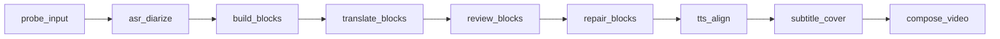

# YouTube入口与BCDE长视频本地化：跨组交付说明

日期：2026-11-17。审核分支：`codex/youtube-full-video-handoff-20261117`。
合并基线：GitHub main `4cef031`，保留C/F截至该提交的更新。本文是跨组变更提案和操作说明，不替代F维护的设计事实源。

## 1. 上传范围与审核状态

本次上传包含此前本地B/C/D/E实验实现、F主图顺序调整提案、YouTube输入入口、配置、测试及各节点文档。不是“只有B内部修改”。提交在独立分支供F与各负责人审核，未直接覆盖main，未宣称团队已同意新架构。

`contracts/`、`utils/artifacts.py`、`graph/registry.py`、`graph/incremental.py`、`config/mock.toml`未改。保护`docs/design/`最新事实源，之前本地workflow改动没有强行写入本分支；需要F确认后修改设计版本和CHANGELOG。main当前全真实节点配置保持原样；首次运行不是无密钥的免费演示。

实验按用户最后要求只上传三文件压缩包：一份实验报告、原片、最终成片。中间音轨、逐组TTS、模型响应、字幕、日志、音色账户记录、参考原声、密钥和模型缓存不上传。大视频经Release附件分发，不进入Git历史。

## 2. YouTube贴链接下载

使用官方[yt-dlp](https://github.com/yt-dlp/yt-dlp)库。依赖继续由`pyproject.toml`的`b-asr`声明、`uv.lock`锁定，不使用pip或手工改锁文件。

```powershell
uv sync --locked --extra b-asr --extra tts --extra sound-events

# 只下载：不会调用翻译、审校或配音API；目录会自动创建。
uv run --locked --extra b-asr download-video "https://www.youtube.com/watch?v=jNQXAC9IVRw" --output-dir jobs/youtube-example

# 启动完整主流程：需要事先配置模型、API和音色，可能收费。
uv run --locked --extra b-asr --extra tts --extra sound-events run-input --work-dir jobs/youtube-example --input input.mp4
```

普通主入口也支持`--input "YouTube链接"`：先创建任务目录，CLI下载到`input.mp4`，再构造原有`GraphState(input_video="input.mp4")`。**链接不会原样传给后续本地媒体节点。** 已有`input.mp4`时明确拒绝覆盖，请使用新任务目录。

对接函数：`nodes.probe_input.youtube.prepare_youtube_input(url, work_dir)`。下载实现复用`nodes.asr_diarize.pipeline.video_inputs.download_input`，下载来源记录为`logs/input-download.json`，属于启动日志辅助信息，不新增共享状态字段。独立B素材API仍可显式传`allow_network`，原接口保留。

默认只取一条公开视频，最高720p、最多2小时、2GiB，下载时限600秒；优先英文/原始兼容音轨。支持watch、youtu.be、shorts、embed、已结束live链接；带播放列表参数的单视频只取该视频，不批量下列表。FFmpeg/ffprobe遵循项目工具查找；自动查找PATH上的Node.js，也可设置`LOCALIZER_NODE_PATH`。YouTube可用性不稳定，私有、付费、地区/登录限制和DRM不保证支持，不读取浏览器Cookie或自动登录。

2026-11-17真实下载验证：`jNQXAC9IVRw`的公开19秒视频成功，仅作本地下载测试，没有调用翻译/配音，也不随实验包上传。最初使用的旧测试视频`BaW_jenozKc`已失效，已确认是视频不可用，不能误称下载器成功。

目前交付的是CLI和Python接口；现有WebUI本地上传入口不因本次提交自动多出YouTube按钮，F/E可调用上述函数接入。

## 3. 各组改动与对接

| 负责范围 | 本次改动 | 必须注意的对接点 |
|---|---|---|
| B | YouTube下载与启动桥接；本地复识别候选过滤；提供背景分离/非语言声音工具和来源验证 | `Segment`字段未改；英文不因字幕美观而重写；下载不会自动授予转载或声音复刻许可 |
| C | 翻译/审校请求增加可用时长和建议字数；加入学校工具桥接与明显英文泄漏检查；保留最新风格配置 | 与C最新`_options.py`兼容；审校/返工逻辑仍按最新分拆，定向返工来自`nodes.repair_blocks`，没有把旧实现覆盖回review模块 |
| D | 原声复刻配置、连续语义组TTS、实测时长、有限变速、局部改稿、原声交谈指令、用量记录 | 当前模型rate=1.0，后期0.95–1.35；不裁尾。复刻音色必须与源摘要、模型、账号及地域匹配 |
| E | 最终音轨识别后生成字幕；中文取最终实际音稿；中上英下居中、两种语言各一行；超宽显示分页；可选背景混音 | 显示分页不切配音。`dubbing_script.json`为实际组稿；`TTSClip.text`只是对应片段的审校/返工标签，不保证是切片逐字实录 |
| F | 主图先D后E；CLI增加可选graph_factory和URL启动准备；新增可选BCDE组合入口 | 共享签名/字段不改，但时序、配置和辅助文件依赖有变化；必须审核，不能直接称“完全无需适配” |

`repaired_blocks`是F/C已经登记的可选字段，不是本次新增。D和字幕节点在它非空时优先使用它；不存在/返工失败时回退`reviewed_blocks`，通过私有副本传给内部函数，不改写原State的审校结果。

C时长预算约每秒4个中文字符，只是建议，实测TTS才决定是否合适。预算配置缺失时保持默认值，不能让C原有风格配置的独立使用突然失败。数字、否定、条件、专名必须保留，不按字数硬截。

## 4. F主图修改：原因与精确变化

原依赖：`repair_blocks → tts_align`与`repair_blocks → subtitle_cover`并行，二者汇合后`compose_video`。

本分支提案：



`builder.WORKFLOW_EDGES`删除`repair_blocks→subtitle_cover`及双前驱汇合，改为`tts_align→subtitle_cover→compose_video`。原因是最终音稿会因配音时长返工改变，字幕必须等待最终音轨，不能与TTS同时基于旧译文生成。

节点名和`state: GraphState -> dict`不变。`repair_blocks`仍始终调度，增量异常隔离仍由F代理执行，返回空增量时基础路径继续。BCDE组合入口同样保留该增量和代理，未另写一套模拟规则。

可选入口：`from nodes.localize_video import build_bcde_graph, localize_video`；命令`uv run ... python -m nodes.localize_video ...`。它是对既有节点的职能封装，不代表新增四个智能体，也未擅自登记成F正式第十个节点。不要把组合入口与完整九节点主图串联再执行一遍。

`cli.main(argv=None, *, graph_factory=None)`保留旧调用形式和默认F主图。关键变化是URL在入图前落为本地文件，及D/E顺序；未修改contracts必填性、返回字段或utils公共签名。

## 5. 辅助产物、背景音与仍待F确认的部分

- D在已有`tts/`目录产生原始音频、`*.timing.json`、`*.speed.json`、`dubbing_script.json`、`alignment_report.json`、时长返工记录；正式`tts_clips`仍按公共工具写入。
- E在`subtitles/`产生最终音轨ASR、局部核对、显示片及警告；三份SRT/ASS仍按原正式路径交付。
- B可发布`audio/environment.wav`及来源摘要回执，E组合入口验证后生成`audio/mixed.wav`和混音回执，`compose_video`核对摘要后消费；缺失可选背景时仍可纯配音。
- **基础F CLI尚不自动运行Demucs/非语言工具，也没有独立的混音节点。** 35分钟历史实验通过准备脚本和BCDE服务注入提供这些结果。仅有源码不等于普通CLI已经自动完成同样背景流程；F应决定是否登记、接入或接管这些可选能力。
- 辅助文件不是新增共享State字段。若团队要把它们升级成正式跨组产物，需F更新dataflow/规格表；本分支不自行改公共登记表。
- F需确认实际配音组稿与`TTSClip.text`标签含义、单行字幕策略、原音色授权准备、检查点/恢复机制，以及设计文档、WebUI拓扑和README同步。当前基本CLI不承诺SQLite中断续跑，历史实验恢复脚本不等同于生产恢复接口。

## 6. API、地域、环境和费用

| 环节 | 方式与本地配置 | 数据外发与费用 |
|---|---|---|
| 下载 | yt-dlp、FFmpeg，可选Node.js | 不调用大模型/TTS，但需要访问YouTube；下载不等于授权使用 |
| 英文/最终中文识别 | 本地faster-whisper及本地模型 | 不上传音频；模型需按B文档准备 |
| 翻译/审校/时长改稿 | 默认`DEEPSEEK_TRANSPORT=api`，配置`DEEPSEEK_API_KEY` | 发送必要英文和中文；可能收费，程序不推断账号余额 |
| 学校桥接 | `DEEPSEEK_TRANSPORT=school_bridge`和`DEEPSEEK_BRIDGE_DIR` | 生成精确摘要绑定请求，需授权平台工具/操作者处理，不是拷贝即用的通用HTTP SDK；缺响应会报待处理，不能当自动续跑 |
| 中文TTS | `DASHSCOPE_API_KEY`，可选`DASHSCOPE_WORKSPACE`，新加坡`DASHSCOPE_REGION=ap-southeast-1` | 发送中文稿和音色/交谈参数，可能收费；地域和音色必须匹配 |
| 首次复刻 | `nodes.voice_profiles.enroll_profiles(..., authorized=True, allow_network=True)` | 上传经授权的10–60秒单人PCM16单声道参考原声，可能另收费；不可自动假定新视频说话人已授权 |
| 背景分离/混音/字幕 | 本地GPU Demucs、可选本地AST、FFmpeg | 不调用配音/翻译API；GPU环境单独准备，主uv锁不假称覆盖旧GPU环境 |

`.env.example`只有空密钥和地域示例，真实`.env`不提交。默认复刻模式需要本机`audio/voice_profiles.json`，该账户绑定记录不上传；没有授权音色时不可悄悄冒用他人音色，可显式改用D支持的system模式。

声音指令会要求保留个人特征、自然交谈；本地原声声学指标不等于逐句原声已经传入WebSocket作style prompt。当前服务接收音色ID、中文稿、instruction、language_hints和rate，不宣传完整情绪迁移、完美音色相似度或口型同步。

用量台账可通过`LOCALIZER_BUDGET_FILE`配置；没有该变量时不自动推算费用。历史整片测试在用户确认取消旧上限后运行，新TTS字符提交尝试10959、学校工具调用97、新注册0，实际账单未知。本次下载、回归和打包不重新调用付费翻译/配音。

## 7. 历史35分钟实验与附件

2026-11-14实验：2109.566秒、638条原文、300组整片新配音、559屏双语单行、0越界，实际速度0.95–1.35，模型rate=1.0。9组忠实短稿留白、29屏少于0.5秒需人工复听；自然度、原声相似度、说话人及精确口型未整片人工验收。B/C使用同源历史结果，D/E真实重跑，不称为全新转写或全新翻译。

历史代码基线为`38560b0`加当时本地变更；不是2026-11-17合并后重新收费跑出的新实验。包含许可、API、复现边界、指标、警告时间和视频SHA256的一份实验报告随包提供。

Release：`https://github.com/AchiDilyar/english-video-localizer/releases/tag/experiment-long35-20261117`。
包名：`long35-experiment-20261117.zip`，922429101字节，SHA256 `47b65c92116c23297124458036d40b4754f1075c0ef1ff3cbb256b00d62e0c1e`。
包内仅`experiment-report.md`、`source.webm`、`localized.mp4`，不再上传中间文件。原片作者The New York Times，CC BY 3.0；详细归属和改编说明写在报告与成片元数据中。

## 8. 验证与合并步骤

依赖统一通过uv声明/锁定/运行。新增pytest importlib导入模式，避免F的mocks测试与nodes测试同名造成收集冲突；不删除任一组的测试。

```powershell
uv run --locked --extra b-asr --extra tts --extra sound-events pytest -m "not slow" -q
```

本轮最终快测：499 passed、2 skipped、2 deselected、11 subtests passed，用时9.79秒。两个可选真实模型用例默认跳过，两个slow用例未执行。旧`tests/smoke/test_full_pipeline.py`仍使用旧SpeechSynthesizer替身和本地模型/工具前提，需F按当前Client.audio.tts.connect及新配置适配后单独验收；本次不冒称该旧慢测通过。历史35分钟实验43项配音测试与本轮合并回归是两次不同验证，不能相加冒称同一次全量验收。

验证时最初全仓收集因mocks/nodes测试同名失败，已用importlib模式修复。曾遇Windows临时文件替换权限/占用问题，单项复核通过后，在全新临时目录按整组顺序重跑得到上述最终快测结果，未删除或修改该测试来掩盖故障。

建议F先检查`graph/builder.py`、CLI URL桥接和上述新增产物依赖，再请C/D/E确认各自模块，更新正式设计/CHANGELOG后合并。当前上传不代表已完成F生产主图、GPU或全部慢速真实API验收。
