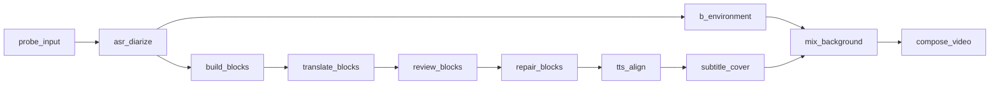

# 统一主图：跨组节点、增量环境音与 API 对接说明

更新：2026-11-17。本修订以 F 的 main `3076a44`、workflow.md 第4节及 architecture.md 8.3 为准，取代上一版另建 BCDE 图的运行说明。历史35分钟实验仍保留，但不能当成本次新主图的整片验收。

## 1. 本次修改范围

- 不修改 F 已更新的 graph/builder.py、registry.py、incremental.py、mock.toml 或主图拓扑。
- 实现正式节点 nodes.b_environment.b_environment 和 nodes.mix_background.mix_background，签名均为 state: GraphState -> dict。
- 停用 python -m nodes.localize_video，移除 CLI 的 graph_factory 注入；run-input 和 WebUI 均走 F 主图。
- localize_video 目录暂时保留：工具引用和旧导入兼容仍在；build_bcde_graph 只弃用转调 graph.build_graph，不创建 StateGraph，不允许旧 StageServices 注入。
- 未新增依赖、未手工改 uv.lock；不提交模型、密钥、音色账号记录或实验中间数据。

## 2. 素材与唯一运行入口

```powershell
# 只下载，不翻译配音
uv run --locked --extra b-asr download-video "https://www.youtube.com/watch?v=jNQXAC9IVRw" --output-dir jobs/youtube-example
# 唯一完整主图入口；需先准备模型/API/音色，可能收费
uv run --locked --extra b-asr --extra speech --extra tts --extra sound-events run-input --work-dir jobs/youtube-example --input input.mp4
```

也可让 run-input 的 --input 接收单条 YouTube URL，在入图前下载为本地 input.mp4。下载不会更换主图；工作目录必须存在，已有输入拒绝覆盖。当前 WebUI 仍是本地 MP4 上传。

## 3. 各组改动与接口

| 组 | 正式节点及职责 | 输入与输出 |
|---|---|---|
| B | probe_input / asr_diarize 保持原文、说话人与时间轴；b_environment 本地 Demucs 分离并保守回添非语言声音 | 读取 input_video、media_info、segments；仅新增 environment_audio 状态回执及环境音，不更改基础字段 |
| C | build_blocks / translate_blocks / review_blocks / repair_blocks | 既有时长预算、翻译审校、定向返工保持；不需要环境音数据 |
| D | tts_align | 继续输出纯中文 dub.wav；可选 repaired_blocks 不存在时使用 reviewed_blocks；背景失败不影响配音 |
| E | subtitle_cover / mix_background / compose_video | 字幕仍等待最终配音；混音仅在当前 environment_audio 有效时执行；成片有有效 mixed_audio 才使用混音，否则使用纯配音 |
| F | graph.build_graph 为唯一主图 | 注册和边集合完全沿用 F 新版；三个增量节点继续由 F 代理隔离异常 |

字幕仍为中文在上、英文在下，各一行。仅显示分页，不修改 B 英文或前面配音分组；纯中文音轨供字幕定位，环境音混入不干扰中文识别。

## 4. 主图顺序



b_environment 与翻译主链并行。mix_background 等待 subtitle_cover 和 b_environment，compose_video 等待 mix_background；不增加条件跳过、不新增主图以外的业务图。

F 当前 mock.toml 中 b_environment=true、mix_background=true，仍为模拟实现。此次只提供真实实现，不擅改 F 配置；F 在准备本地模型后可将这两项设为 false。节点始终参与调度，模拟/真实不改变拓扑。

## 5. 增量产物、数据流与兼容性

| 名称 | 路径 | 生产/消费 |
|---|---|---|
| environment_bed | audio/environment.wav | B → E 混音 |
| environment_audio | audio/environment.source.json | EnvironmentAudio 同步写盘并返回 State；绑定源视频、segments 与环境音摘要 |
| mixed_track | audio/mixed.wav | E 混音 → 成片 |
| mixed_audio | audio/mixed.mix.json | MixedAudio 同步写盘并返回 State；绑定源视频、环境音、中文配音与混音摘要 |

GraphState 新增 environment_audio、mixed_audio，均可选默认 None；基础字段保持不变。固定路径不入 State，下游从 State 读回执，通过 artifact_path 取媒体；结构化回执使用 write_artifact。模型、导出、生成脚本、interfaces.md、contracts/CHANGELOG、dataflow 产物表与 utils/artifacts 同步更新。

增量节点不修改输入 state，不覆盖 source.wav/dub.wav。分离 stems、事件特征及底层诊断仅为私有临时文件，成功或失败后清理。并行的 B 与 C 写不同字段。

没有环境音状态时混音返回 {}；背景或混音抛异常由代理返回 {}。没有有效 mixed_audio 时成片使用 dub.wav，即使目录残留旧 mixed.wav 也不使用。发布后媒体缺失或摘要不匹配同样警告并回退，不能让可选增量阻断基础成片。

### 本地模型与声音边界

config/b_environment.toml：默认 CPU，Demucs 权重位于 models/background-demucs，AST ONNX 位于 models/ast-audioset。路径相对仓库，也支持绝对路径。节点不自动下载模型，不外发音频。config/mix_background.toml 控制背景增益，默认0.7。

新版节点只依赖公开 segments，不依赖旧实验的私有逐词文件。AST 只在句子语音区间之外提议笑声等非语言事件，回添前再扣除语音区间及80ms保护。相比历史逐词防护更保守，可能遗漏句中笑声；Demucs 为音乐声部分离模型，不能保证清除所有语言、保留全部环境声。未实现 SAM Audio 或任意背景说话人的完美区分。

## 6. API、地域、环境和费用

| 环节 | 方式与本地配置 | 数据外发与费用 |
|---|---|---|
| 下载 | yt-dlp、FFmpeg，可选Node.js | 不调用大模型/TTS，但需要访问YouTube；下载不等于授权使用 |
| 英文/最终中文识别 | 本地faster-whisper及本地模型 | 不上传音频；模型需按B文档准备 |
| 翻译/审校/时长改稿 | 默认`DEEPSEEK_TRANSPORT=api`，配置`DEEPSEEK_API_KEY` | 发送必要英文和中文；可能收费，程序不推断账号余额 |
| 学校桥接 | `DEEPSEEK_TRANSPORT=school_bridge`和`DEEPSEEK_BRIDGE_DIR` | 生成精确摘要绑定请求，需授权平台工具/操作者处理，不是拷贝即用的通用HTTP SDK；缺响应会报待处理，不能当自动续跑 |
| 中文TTS | `DASHSCOPE_API_KEY`，可选`DASHSCOPE_WORKSPACE`，新加坡`DASHSCOPE_REGION=ap-southeast-1` | 发送中文稿和音色/交谈参数，可能收费；地域和音色必须匹配 |
| 首次复刻 | `nodes.voice_profiles.enroll_profiles(..., authorized=True, allow_network=True)` | 上传经授权的10–60秒单人PCM16单声道参考原声，可能另收费；不可自动假定新视频说话人已授权 |
| 背景分离/混音/字幕 | 本地GPU Demucs、可选本地AST、FFmpeg | 不调用配音/翻译API；GPU环境单独准备，主uv锁不假称覆盖旧GPU环境 |

`.env.example`只有空密钥和地域示例，真实`.env`不提交。默认复刻模式需要本机`audio/voice_profiles.json`，该账户绑定记录不上传；没有授权音色时不可悄悄冒用他人音色，可显式改用D支持的system模式。

声音指令会要求保留个人特征、自然交谈；本地原声声学指标不等于逐句原声已经传入WebSocket作style prompt。当前服务接收音色ID、中文稿、instruction、language_hints和rate，不宣传完整情绪迁移、完美音色相似度或口型同步。

用量台账可通过`LOCALIZER_BUDGET_FILE`配置；没有该变量时不自动推算费用。历史整片测试在用户确认取消旧上限后运行，新TTS字符提交尝试10959、学校工具调用97、新注册0，实际账单未知。本次下载、回归和打包不重新调用付费翻译/配音。

## 7. 历史35分钟实验与附件

2026-11-14实验：2109.566秒、638条原文、300组整片新配音、559屏双语单行、0越界，实际速度0.95–1.35，模型rate=1.0。9组忠实短稿留白、29屏少于0.5秒需人工复听；自然度、原声相似度、说话人及精确口型未整片人工验收。B/C使用同源历史结果，D/E真实重跑，不称为全新转写或全新翻译。

历史代码基线为`38560b0`加当时本地变更；不是2026-11-17合并后重新收费跑出的新实验。包含许可、API、复现边界、指标、警告时间和视频SHA256的一份实验报告随包提供。

Release：`https://github.com/AchiDilyar/english-video-localizer/releases/tag/experiment-long35-20261117`。
包名：`long35-experiment-20261117.zip`，922429101字节，SHA256 `47b65c92116c23297124458036d40b4754f1075c0ef1ff3cbb256b00d62e0c1e`。
包内仅`experiment-report.md`、`source.webm`、`localized.mp4`，不再上传中间文件。原片作者The New York Times，CC BY 3.0；详细归属和改编说明写在报告与成片元数据中。


## 8. 本次验证与待办

全仓快速回归：`uv run --offline --locked pytest -m "not slow" -q`，514 passed、2 skipped、2 deselected、11 subtests passed（12.34秒）。日志：tests/tmp/main-aligned-final-20261117.log。两项慢测未运行，两个真实模型测试默认跳过。

后续摘要稳定性保护改动后，相关节点/主图/CLI 回归33项通过（5.58秒）；新增文件 Ruff 检查通过。最终交付回归：515 passed、2 skipped、2 deselected、11 subtests passed（12.06秒）；日志 tests/tmp/main-aligned-verified-20261117.log。新增文件 Ruff 检查及文档相对链接检查通过。

真实 LangGraph 主图 + FFmpeg 合成测试覆盖正常混音、背景抛异常、混音抛异常和增量缺失，均生成有效2秒音视频；神经分离、识别、翻译、配音使用测试替身，不能宣传为真实模型整片验收。旧 B→C 联调用例从按注册表前五项改为显式节点名，以适应并行背景节点。

本次 DeepSeek 和 TTS API 调用均为0。Windows 普通权限曾拒绝既有下载回执替换/上传硬链接，未修改无关业务逻辑；在获准权限下完成上述全仓回归。历史实验的模型用量与成片质量不作为本次新主图的自动验收。

待办：真实 Demucs/AST 模型在统一 Python 3.11 环境下的质量和耗时验收、GPU 验收、旧慢测 SDK 适配；其他 D/E 辅助产物的全面规范化不在本次新增环境音产物范围内。没有为本次结构调整重新提交整片付费翻译/配音。
